# 📊 DataPilot: Self-Correcting Data Analyst

**Track 3 · Agentic AI · AutoGen.** Ask a business question in plain English. A team of AutoGen agents
plans, writes Python, runs it in a sandbox, fixes its own errors, gets reviewed, and returns a plain-English
answer with charts, the re-runnable `analysis.py` and a one-page PDF.

**Live:** https://www.kowsalyagroups.com/techstack/datapilot/

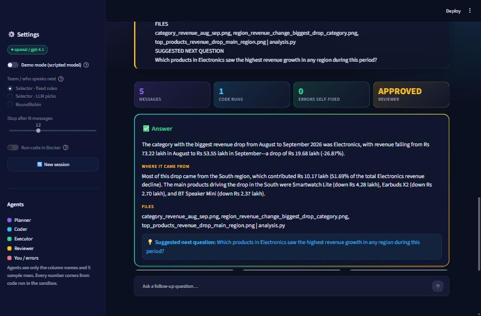

---

## How it works

```
01 Ask  ›  02 Plan  ›  03 Code  ›  04 Run  ›  05 Review  ›  06 Answer
                         ▲           │            │
                         └── error ──┘            │
                         └──────── feedback ──────┘
```

| Agent | AutoGen class | Job |
|---|---|---|
| 🧭 **Planner** | `AssistantAgent` | Reads the question + column schema (never the full data) and writes a 3-6 step plan |
| 💻 **Coder** | `AssistantAgent` | Writes one complete pandas + matplotlib script; rewrites it on an error or on feedback |
| ⚙️ **Executor** | `CodeExecutorAgent` (+ `LocalCommandLineCodeExecutor` / `DockerCommandLineCodeExecutor`) | Runs the code in the sandbox, tags `STATUS: OK / ERROR`, saves `analysis.py`, tracks charts |
| 🔍 **Reviewer** | `AssistantAgent` | CHECKs every part of the question against printed numbers and chart labels, then replies `FEEDBACK:` or the final answer + `APPROVED` |
| 👤 **User** | `UserProxyAgent` | The human: approves the answer or asks a follow-up that continues the same session |

**Team** (pick in the sidebar):
- `SelectorGroupChat` with fixed rules (default): Executor error → Coder, Executor OK → Reviewer, feedback → Coder.
- `SelectorGroupChat` with LLM selection (stretch goal): the model picks the next speaker.
- `RoundRobinGroupChat`: fixed turn order Planner → Coder → Executor → Reviewer.

**Stop:** `TextMentionTermination("APPROVED", sources=["Reviewer"]) | FunctionalTermination(final answer) | MaxMessageTermination(12)`.

## Assignment tech stack: what is used

| Assignment item | Where in this project |
|---|---|
| AssistantAgent: Planner, Coder, Reviewer with system messages | `team.py`: `PLANNER_PROMPT`, `CODER_PROMPT`, `REVIEWER_PROMPT` |
| CodeExecutorAgent with Docker or local executor | `team.py`: `SandboxExecutorAgent`, `_make_code_executor()`; Docker toggle + `Dockerfile.sandbox` |
| RoundRobinGroupChat (stretch: SelectorGroupChat) | `team.py`: `build_session(routing=...)`, all three modes |
| TextMentionTermination('APPROVED') \| MaxMessageTermination(12) | `team.py`: `termination` |
| UserProxyAgent (human-in-the-loop) | `app.py`: `human_says()` for Approve + follow-ups; `cli.py`: terminal prompt |
| pandas, matplotlib (numbers from code, not from the LLM) | Coder scripts; the LLM only sees the schema and 5 sample rows |
| Streamlit chat interface | `app.py`, `ui.py`, `.streamlit/config.toml` |

## Self-correction, live (gpt-4.1, messy real-world Excel)

Clean demo data rarely makes gpt-4.1 fail, so the self-correcting loop has to prove itself on realistic data.
`sample_data/sales_2026_messy.xlsx` (the **🧪 Messy real-world export** button) holds the same sales as a typical
shop/ERP export: three date formats (`2026-08-02`, `02/08/2026` day-first, `02-Aug-2026`), prices as text
(`₹1,999`), discounts as `10%` or `0.10`, region spelling variants (`South`, `south `, `SOUTH`), blank cells, and a
second `Region_Targets` sheet.

The sandbox gives the Coder a `data_check()` it must call after cleaning, and it also checks every saved chart.
These turn **silent wrong numbers into real errors**:

| Sandbox check | Fails when |
|---|---|
| rows lost | more than 2% of rows dropped by the cleaning |
| dates | values that did not parse; ISO dates with day/month swapped; `dd/mm/yyyy` read month-first (compared with a pristine copy of the loaded file) |
| names | the same group value spelled two ways (`North` / `north `) |
| charts | a saved chart has no title, x or y label, or no units on the y axis |

Question: *"Using both sheets, which region missed its September revenue target by the most, and by how much?"*

| Step | Screenshot |
|---|---|
| Live error 1: `DATA CHECK failed: 8310 values in 'Order Date' could not be parsed` | 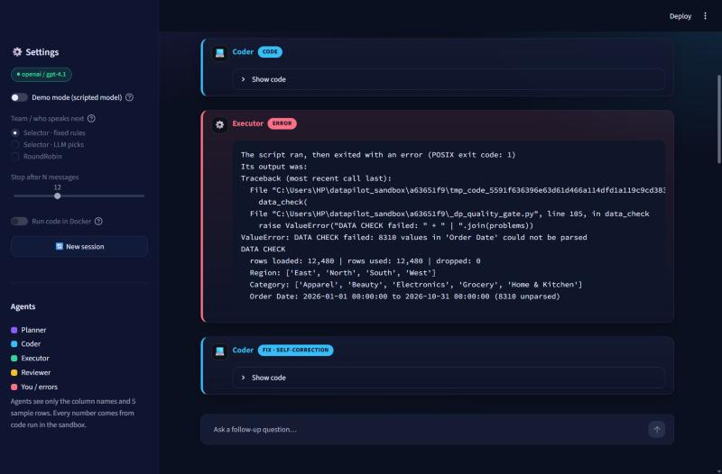 |
| Coder fixes it, live error 2: `1,496 ISO dates were parsed with day and month swapped` | 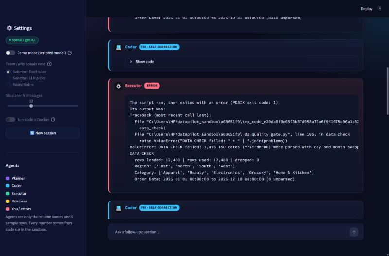 |
| Coder fixes it again: DATA CHECK passed, correct numbers | 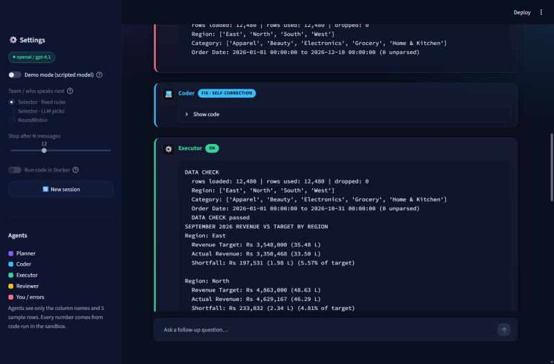 |
| Approved answer: **North, Rs 2.34 L short** (correct), errors self-fixed counter | 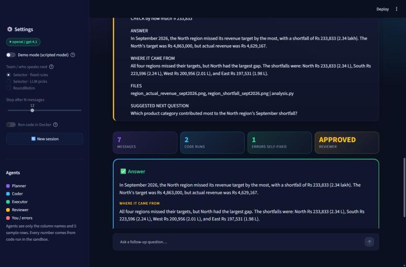 |

**Measured (6 final live runs on the messy data):** 6 of 6 correct, 4 of 6 fixed at least one real error on their
own. Before the sandbox checks, the same runs were often **approved with wrong numbers** (e.g. 67% of rows silently
dropped, or "North short Rs 5.27 L" instead of 2.34 L). The checks also caught a `KeyError: 'region'` and missing
chart labels in other runs.

## Expected outputs (screenshots)

| # | Expected output | Screenshot |
|---|---|---|
| 1 | Upload a CSV / Excel and ask in plain English | 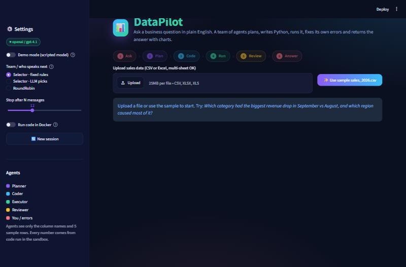 |
| 2 | Watch the agents work live (animated pipeline) | 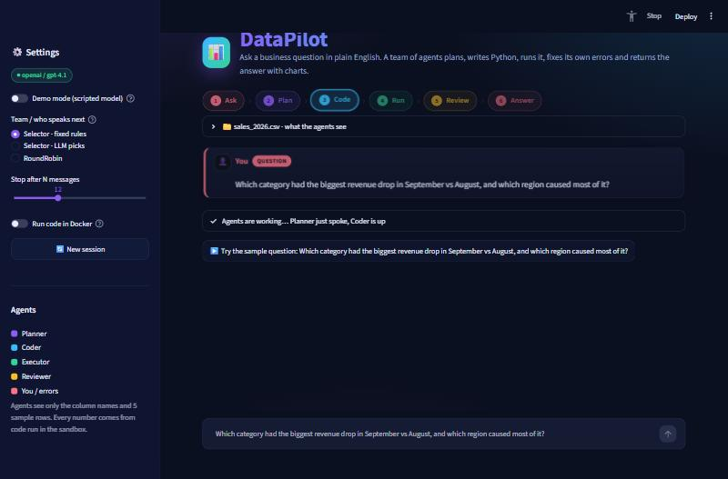 |
| 3 | Planner plan → Coder code → Executor run | 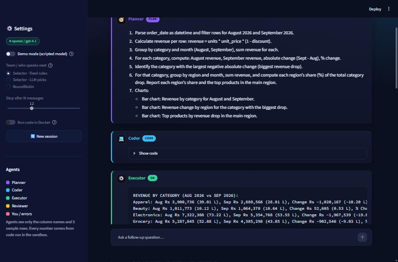 |
| 4 | Numbers calculated by code (category, region, products) | 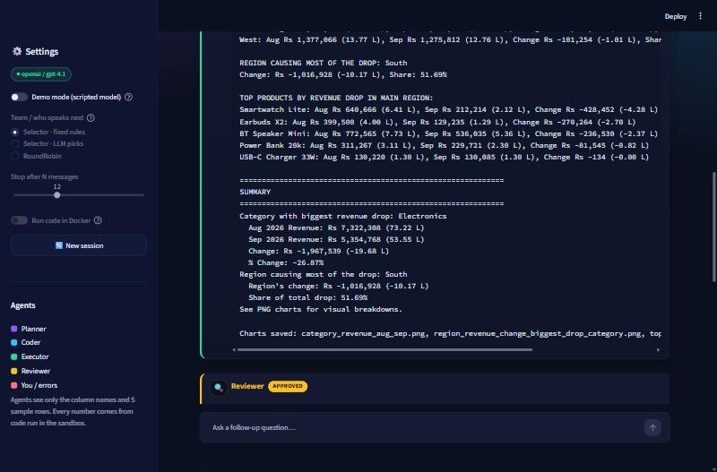 |
| 5 | **ERROR then Fixed**: live data-check failures fixed by the Coder (see above); demo mode: `KeyError: 'revenue'` |  |
| 6 | Demo mode: scripted mistake, real traceback, Coder repairs its own code | 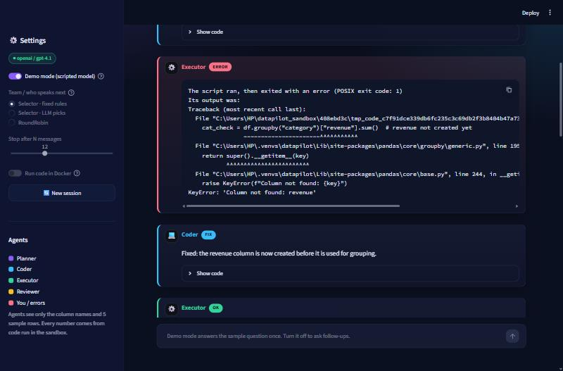 |
| 7 | Reviewer CHECKs every part of the question, then APPROVED | 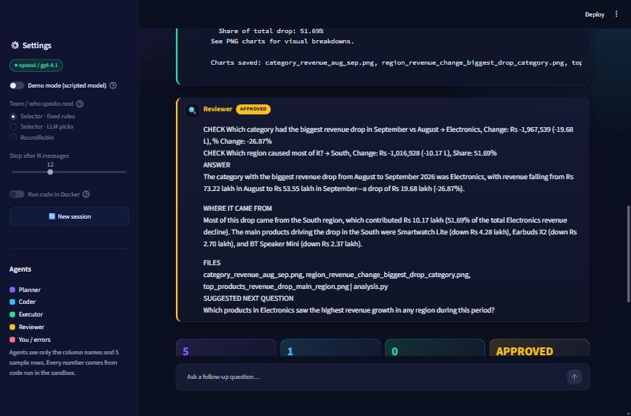 |
| 8 | Final answer: exact numbers, where it came from, files, suggested next question |  |
| 9 | Charts as PNG + downloads (analysis.py, charts, PDF) + human Approve | 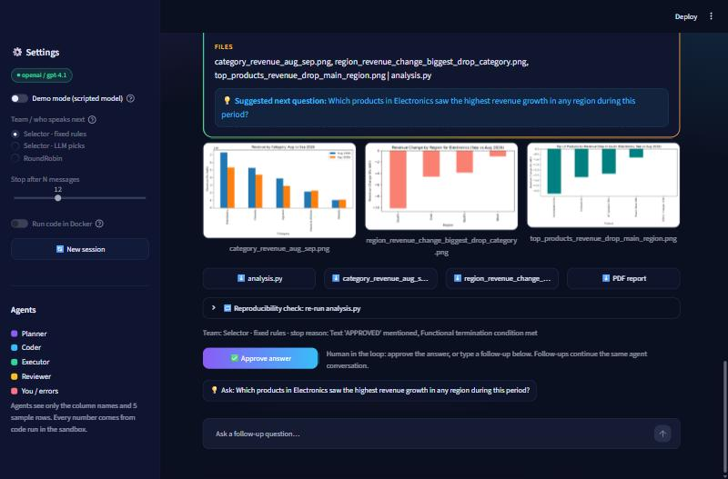 |
| 10 | Re-running analysis.py gives exactly the same numbers | 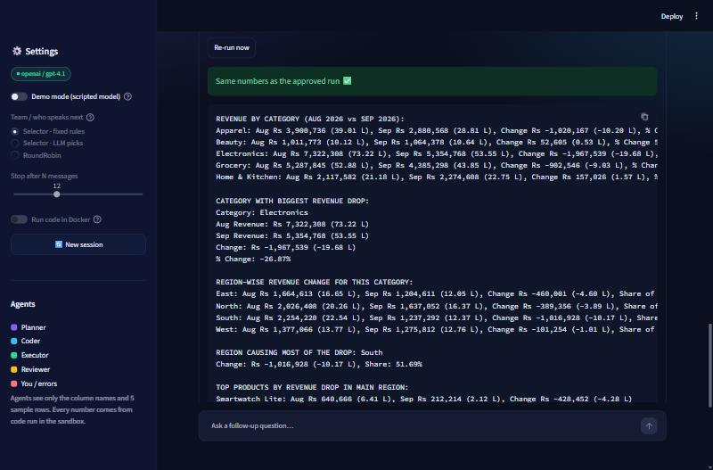 |
| 11 | Follow-up question continues the same session | 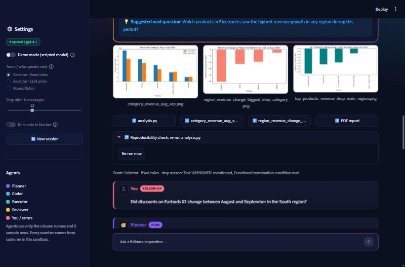 |
| 12 | Follow-up answer with its own chart | 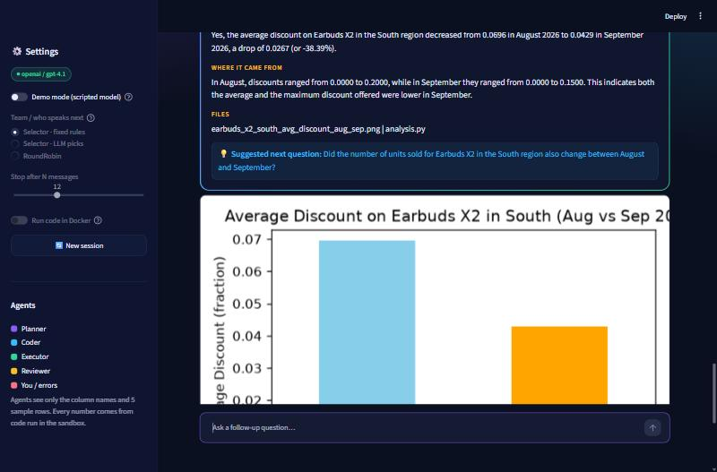 |
| 13 | Deployed on the VPS (Docker sandbox, daily run cap), live gpt-4.1 run approved | 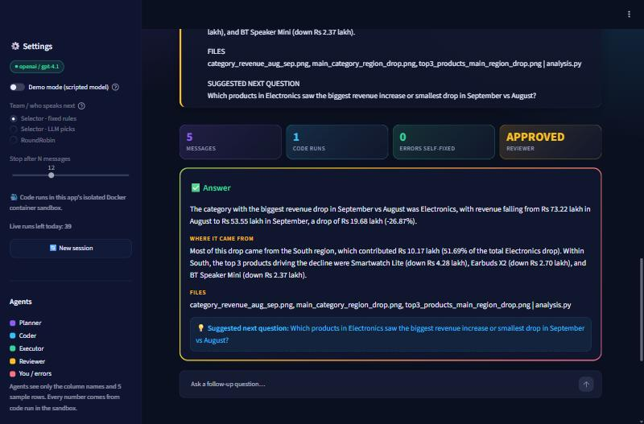 |

All screenshots except 6 are from **live gpt-4.1 runs**. Screenshot 6 is **demo mode** (no API key): a scripted
model makes the classic mistake on purpose, then trips the chart check; the tracebacks and fixes really run.

Real files from the live run: [`docs/sample_output/`](docs/sample_output) (`analysis.py`, 3 charts, `report.pdf`).

**Live answer (gpt-4.1, sample data):** Electronics had the biggest drop: revenue fell from Rs 73.22 L in
August to Rs 53.55 L in September (−Rs 19.68 L, −26.87%). The South region caused Rs 10.17 L of it (51.69%),
mainly Smartwatch Lite (−4.28 L), Earbuds X2 (−2.70 L) and BT Speaker Mini (−2.37 L).

## Daily run limit

The public app spends on the OpenAI key, so it allows **3 live runs per day** (`MAX_RUNS_PER_DAY`; `0` = no
limit). Each question, follow-up or "let the agents continue" is one run, counted when it starts. The count
resets at midnight India time; demo mode is free and not counted. The sidebar shows runs used and left.

## Done checklist

- [x] At least one run shows the agents fixing a code error on their own (live: 4 of 6 messy-data runs; see "Self-correction, live")
- [x] Code runs only inside the sandbox folder or Docker container (unsafe calls such as subprocess, network and file deletes are blocked)
- [x] Run stops on APPROVED or after 12 messages, never loops forever (tested both ways)
- [x] Running the saved analysis.py again gives exactly the same numbers (button in the app + test)
- [x] Every chart has a title, axis labels and units (enforced by the sandbox chart check)
- [x] Human approval step works, and a follow-up question continues the same session
- [x] Stretch: SelectorGroupChat (LLM picks the speaker), Excel files with multiple sheets, one-page PDF report

`python test_offline.py` checks all of these without an API key.

## Run locally (Windows)

```powershell
py -3.11 -m venv C:\Users\HP\.venvs\datapilot
C:\Users\HP\.venvs\datapilot\Scripts\python -m pip install -r requirements.txt
copy .env.example .env          # add OPENAI_API_KEY (LLM_MODEL=gpt-4.1 recommended)
C:\Users\HP\.venvs\datapilot\Scripts\python -m streamlit run app.py
```

- **Demo mode** (sidebar) needs no API key.
- CLI with the `UserProxyAgent` prompt: `python cli.py sample_data/sales_2026.csv "your question" [--routing round_robin|llm] [--demo]`.
- `python make_sample_data.py` regenerates `sample_data/sales_2026.csv` (12,480 rows), the two-sheet `.xlsx`, and the
  messy real-world versions `sales_2026_messy.csv` / `.xlsx`.
- On Windows keep the venv at a short path (long paths break pip and the sandbox). Pandas/pyarrow are pinned to
  builds that Smart App Control allows.

**Model choice:** gpt-4o-mini often approved vague or wrong breakdowns. gpt-4.1 answered 3 of 3 clean-data test runs
correctly. A cheap Coder (`CODER_MODEL=gpt-4o-mini`) with a gpt-4.1 Reviewer was tested and was worse (wrong
numbers approved, one run stuck in an error loop), so all agents use gpt-4.1 by default. Per-agent overrides:
`PLANNER_MODEL`, `CODER_MODEL`, `REVIEWER_MODEL`.

## Deploy on the Hostinger VPS (next to ReviewLens)

ReviewLens' Caddy serves the domain and imports route files from `/opt/reviewlens/sites.d/`.

```bash
git clone https://github.com/prasanth-sundararajan/datapilot.git /opt/datapilot
cd /opt/datapilot
cp .env.example .env    # OPENAI_API_KEY, LLM_MODEL=gpt-4.1, MAX_RUNS_PER_DAY=3
docker compose -f docker-compose.yml -f docker-compose.prod.yml up -d --build
cp deploy/datapilot.caddy /opt/reviewlens/sites.d/
docker exec reviewlens-caddy-1 caddy reload --config /etc/caddy/Caddyfile --adapter caddyfile
```

App: `https://<APP_DOMAIN>/techstack/datapilot/`.

### Update the server later

```bash
cd /opt/datapilot && git pull && docker compose -f docker-compose.yml -f docker-compose.prod.yml up -d --build
```

## Project layout

```
app.py              Streamlit chat UI (pipeline, agent cards, answer, downloads, approve, follow-ups)
ui.py               5-colour palette + CSS animations
team.py             agents, sandbox executor, routing, termination
config.py           LLM provider/model from .env (OpenAI, Anthropic, Groq, Gemini, OpenRouter, Ollama)
data_utils.py       stage CSV/Excel into the sandbox, schema for the agents
report.py           parse the answer, PDF export, reproducibility re-run
demo.py             scripted model for offline demo / tests
usage_guard.py      daily run limit (MAX_RUNS_PER_DAY, default 3, resets at midnight IST)
cli.py              terminal version with UserProxyAgent
test_offline.py     checklist tests (no API key)
Dockerfile, docker-compose*.yml, deploy/datapilot.caddy   VPS deployment
```
